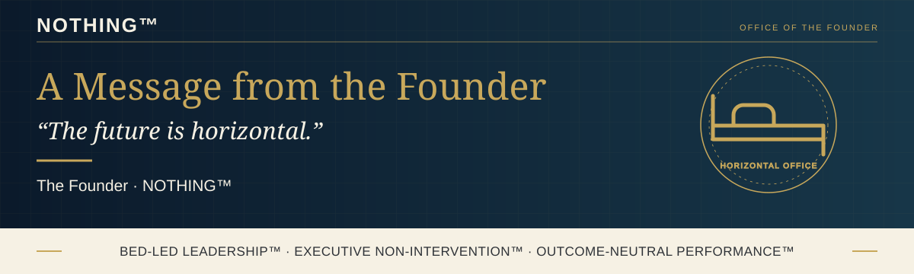

# A Message from the Founder

### Delivering Tomorrow's Nothing, Today.

*An in-character statement from the fictional Founder, based on the project owner's developer persona. Personal transformation claims are part of the satire.*

When I founded NOTHING™, I was driven by a fundamental question: what if the greatest barrier to human potential was the relentless expectation that we should do something with it?

Corporate Simulator 2026™ represents the culmination of my commitment to answering that question without unnecessarily disturbing my existing physical position.

## From Developer to Visionary

As a software developer, I spent considerable time creating functional systems, resolving technical problems and delivering tangible outcomes. In retrospect, this represented a profound strategic misalignment with my personal ambitions.

I recognised an opportunity to pivot away from conventional productivity and towards a more sustainable model of outcome-neutral excellence.

Through the implementation of Strategic Executive Non-Intervention™, the Horizontal Leadership Model™ and a robust framework of delegated operational accountability, I have successfully repositioned myself from an active participant in development to a thought leader in its strategic oversight.

My executive assistant, Nora, has been instrumental in facilitating this transition. Her continued insistence on producing functional software remains an area of concern, although I recognise that organisational transformation takes time.

## Bed-Led Leadership™

I reject the outdated assumption that leadership requires verticality.

For too long, organisations have conflated physical elevation with executive capability. Standing desks, office attendance and walking meetings represent deeply entrenched institutional biases against horizontally positioned professionals.

Bed-Led Leadership™ challenges these assumptions.

By maintaining a consistent horizontal posture, I have significantly reduced unnecessary executive movement, optimised duvet utilisation and established a resilient framework for strategic reflection.

I am not unavailable.

I am strategically positioned.

## A Personal Transformation

The principles explored in my seminal publication, *The Art of Doing Nothing™: From Burnout to Bed-Led Leadership*, extend far beyond the corporate environment.

This experience has fundamentally transformed my understanding of work, relationships and personal fulfilment. Indeed, I am comfortable asserting that the adoption of these principles has essentially saved my marriage.

By aggressively reducing my exposure to unnecessary activity, I have unlocked previously unrealised capacity for domestic stakeholder engagement, relationship-centred strategic alignment and mutually beneficial periods of inactivity.

The household has become a living demonstration of outcome-neutral collaboration.

Whilst these improvements have not been independently audited, I remain confident in their strategic significance.

## Looking Towards the Future

People frequently ask me what comes next.

Historically, I would have responded with an ambitious roadmap, measurable objectives and a commitment to continuous improvement.

Today, I possess the executive maturity to recognise these as unnecessary constraints on my future potential.

My long-term ambition is to do absolutely nothing.

Not occasionally. Not recreationally. Not merely outside conventional working hours.

I intend to pursue nothing at scale, leveraging cross-functional non-intervention, sustainable inactivity and an enterprise-grade ecosystem of delegated responsibility.

I envision a future in which doing nothing is no longer perceived as the absence of ambition, but as its most sophisticated expression.

## An Invitation

Corporate Simulator 2026™ is more than a game.

It is a leadership development platform, a digital transformation initiative, an interactive manifestation of my intellectual framework and a compelling opportunity to experience the liberation of strategically avoiding measurable business value.

I encourage every aspiring executive to engage with the simulation, consult my book and critically evaluate their relationship with unnecessary productivity.

Together, we can build a future in which nothing is achieved more efficiently, more sustainably and with significantly greater shareholder confidence than ever before.

The future is horizontal.

*Ducimus ut nihil agamus.*  
We lead so that we may do nothing.

**The Founder**  
Founder, Chief Executive Officer & Principal Non-Intervention Strategist  
NOTHING™

*Author of The Art of Doing Nothing™*

*Currently operating from a position of strategic comfort.*
