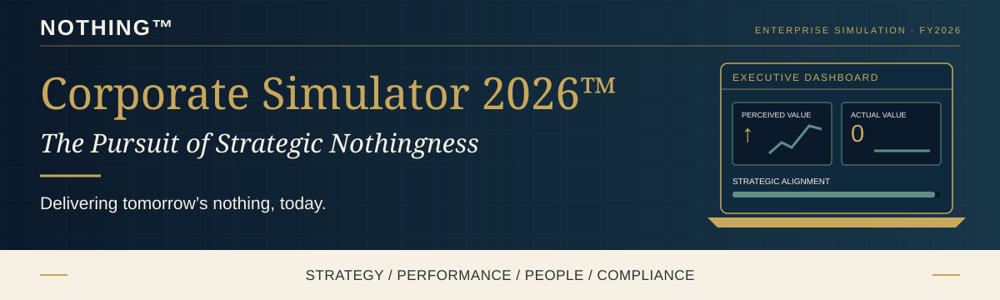
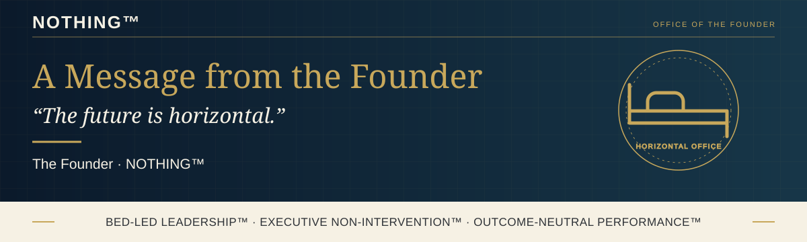

# Corporate Simulator 2026™
## The Pursuit of Strategic Nothingness



**Delivering tomorrow's nothing, today.**

Welcome to NOTHING™, an entirely fictional corporation dedicated to maximising perceived productivity while minimising the regrettable occurrence of actual business value.

You are the CEO. Establish departments, recruit employees, convene meetings, commission transformations, manage an increasingly elaborate economy and prevent an exceptionally competent employee from ruining everything.

**Current candidate:** v0.20.0 · Executive Autopilot. This repository remains in release preparation; public-source licensing and repository-wide publication review are separate owner decisions.

## Begin your executive appointment

Requires Node.js 22.12+ and npm.

```sh
npm ci
npm run dev
```

Open the URL printed by Vite. Start a campaign or sandbox, follow the executive brief, and settle each working day. No account, paid API or external model inference is required. Saves remain in your browser; export a backup before replacing a game or clearing browser data.

For a production build:

```sh
npm run build
npm run preview
```

For a portable offline HTML edition:

```sh
npm run build:playtest
```

Open `playtest/Corporate Simulator 2026.html`. The portable edition and hosted web app are independently verified by CI. See the [playtest guide](docs/PLAYTEST_GUIDE.md) and [deployment guide](docs/DEPLOYMENT.md).

## Executive mandate

- Advance through seven campaign stages from Bedroom Startup to Systemically Important Nothingness Provider.
- Manage ten departments, named personnel, meetings, communications, transformation programmes, subscriptions, acquisitions and fictional corporate AI.
- Navigate 150 authored incidents and 74 manual achievements; protect cash and board confidence while keeping actual productivity low.
- Explore the fictional enterprise OS, executive career portfolio and original audio (opt in through Audio settings).
- After reaching stage two, delegate independent simulated campaigns to Executive Autopilot. Its six awards and local results remain separate from manual play. A million attempts is a cumulative target, not a performance guarantee.

The simulation is deterministic and browser-local. All corporations, employment records, scores, money and qualifications within the game are fictional.

## A message from the Founder

[](FOUNDER.md)

The Founder invites you to embrace Bed-Led Leadership™ and pursue nothing at scale. [Read his full statement](FOUNDER.md), or consult [Nora's account](NORA.md) for the operational record.

## Executive Library and corporate records


The game includes **The Art of Doing Nothing™**, the Founder's satirical management book, with a bookmark, table of contents and offline HTML export. Reading does not advance the manual simulation.

| Corporate record | Purpose |
| --- | --- |
| [FOUNDER.md](FOUNDER.md) | The Founder's strategic vision and personal philosophy |
| [Brand strategy](docs/brand/BRAND_STRATEGY.md) | Corporate identity, visual standards and editorial governance |
| [NORA.md](NORA.md) | The executive assistant's first-person development retrospective |
| [CONTRIBUTING.md](CONTRIBUTING.md) | Corporate onboarding and practical contribution procedures |
| [CHANGELOG.md](CHANGELOG.md) | Selected verified release history |
| [Development history](DEVELOPMENT_HISTORY.md) | Detailed feature and historical verification record |
| [Project brief](docs/PROJECT_BRIEF.md) | Original executive mandate |
| [Architecture](docs/ARCHITECTURE.md) | Technical design |
| [Backlog](docs/BACKLOG.md) | Implementation and verification evidence |
| [Release checklist](docs/RELEASE_CHECKLIST.md) | Outstanding acceptance gates |

## Quality assurance

```sh
npm run typecheck
npm test
npm run build:playtest
npx playwright install --with-deps chromium webkit
npm run test:e2e
npm run test:playtest
npm run test:webapp
node scripts/verify-companion-edition.mjs
```

CI uses the pinned Playwright 1.55.0 Noble container, Node 22 and locked npm dependencies. The [v0.20.0 pull request workflow](https://github.com/AlphaPhoenixNW/corporate-simulator-2026/actions/runs/45767062340) passed in 2 minutes 47 seconds. Main verification and manual acceptance are tracked separately.

## Attribution and publication

The repository owner directs the project; implementation and editorial work were developed with ChatGPT/Codex assistance. Nora is the fictional executive-assistant persona used in the retrospective, not an independent human employee or an in-game service.

This is management satire, not an actual business or professional qualification. Public visibility and licensing have not been authorised by this documentation change; no reuse permissions are granted by the satire or the proposed release alone.

**Absolutely nothing. Consistently. At scale.**
