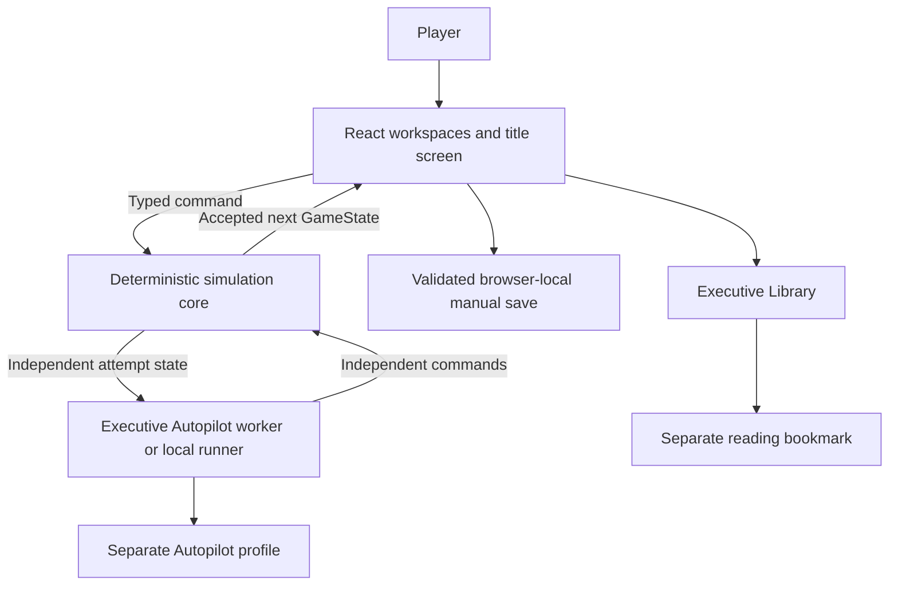
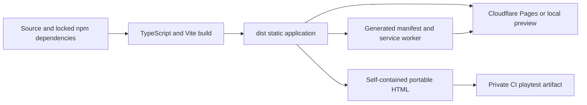

# Architecture | How the simulation works

Current design for the v0.20.0 gameplay baseline. See [status](STATUS.md) for acceptance evidence and [architecture history](ARCHITECTURE_HISTORY.md) for earlier design notes.

## 1. What runs where

Corporate Simulator is a self-contained browser application built with React, TypeScript and Vite. There is no application server, account system, remote database or real AI inference. The hosted edition delivers static assets; the portable edition inlines the application in one HTML file. The same rules drive manual play, regression campaigns and Executive Autopilot.

The core is the rules and command dispatcher, not every file in the engine directory: Autopilot's runner and profile persistence are adapter code. Manual and automated campaigns use separate state instances. The arrows do not imply that automated results replace the manual save.

## 2. Source map

| Path | Responsibility |
| --- | --- |
| [src/main.tsx](../src/main.tsx) | React application, current manual state, dispatch integration, workspaces, title and library transitions |
| [src/engine/types.ts](../src/engine/types.ts) | Typed commands, serializable game state, domain records and metric definitions |
| [src/engine/simulation.ts](../src/engine/simulation.ts) | Seeded new game, command validation, financial recording, daily settlement, ending checks and achievements |
| [src/engine/](../src/engine/) | Departments, employees, meetings, communications, programmes, finance, OS, agents, incidents, campaign, boss and achievements |
| [src/storage.ts](../src/storage.ts) | Save validation, migration and persistence; campaign and achievement profiles |
| [src/ui/](../src/ui/) | Workspace panels, navigation, recommendations, onboarding, audio, receipts, CV and Autopilot presentation |
| [src/library/](../src/library/) | Allowlisted companion text, escaped rendering, reading position and HTML export |
| [scripts/](../scripts/) | Hosted web-app packaging, portable HTML packaging, offline smoke tests and companion verification |
| [tests/](../tests/) | Unit/integration, browser and legal-command campaign regression tests |
| [.github/workflows/ci.yml](../.github/workflows/ci.yml) | Locked dependencies, builds, full quality gates and artifact upload |

## 3. Manual simulation and command flow

A game starts with a seed, campaign or sandbox mode, difficulty and scenario. GameState contains cash, metrics, executive capacity, employees, departments, records, events, pending effects, campaign and RNG state. Monetary values use integer pounds and core scores are bounded to 0–100. Cash and executive compensation are separate.

The UI proposes a typed Command. The dispatcher rejects invalid commands by returning the existing state, or produces an updated state with actual effects. Presentation derives indicators, recommendations, notifications, receipts and career records from that state. The core does not depend on React or browser storage.

One turn is one working day. A pending incident must be resolved before ending the day. Daily settlement follows this ordered sequence in simulation.ts:

1. Base revenue, overhead and daily metrics.
2. Meetings and competent employee confrontation; available employee time feeds subsequent systems.
3. Department operations, payroll, employee activity and staffing synchronisation.
4. Transformation programmes, communications and financial operations.
5. Simulated OS and agent activity; financial day close and any quarterly report.
6. Advance day, replenish executive capacity, apply due delayed effects and select eligible incidents.
7. Check ending conditions and update achievements.

The seeded RNG is persisted. Tests exercise deterministic replay and cash reconciliation. Changes to phase order can affect balance and must be tested.

## 4. Progression and presentation

Seven campaign stages introduce requirements, funding and capabilities. Sandbox removes campaign gates and victory while retaining ordinary failure conditions. The competent employee encounter is an additional final-stage challenge.

React presents one focused workspace at a time, with global cash, capacity, notices and day settlement. Progressive discovery recommends workspaces without creating new gameplay restrictions; Show all workspaces remains available. Recommendations do not execute commands automatically. Title, optional induction, receipts, audio preferences and library reading are presentation features. The CV derives fictional records from actual state and exports HTML or uses the browser print dialogue.

## 5. Persistence and privacy boundaries

| Data | Location and behaviour |
| --- | --- |
| Manual game | Browser localStorage; save schema V13, legacy V1–V12 migration via storage.ts |
| Lifetime manual achievements and highest stage | Separate browser-local profiles |
| Audio, accessibility and navigation preferences | Local preferences, separate from simulation state |
| Active title/game session | Session storage |
| Manual backup | Versioned JSON envelope containing game, highest stage and manual achievement profile; validated before import |
| Autopilot | Separate version-1 local profile; completed attempts, cumulative results and mandate |
| Book bookmark | Separate local reading-position key |

Browser storage is origin/profile-local and may be unavailable or cleared by the browser. Export manual backups when moving devices or hosts. Manual backup does not contain the separate Autopilot profile or preferences. No application account or cloud synchronisation is implemented.

## 6. Executive Autopilot

Autopilot is available after reaching campaign stage two. The policy in [autopilotStrategy.ts](../src/engine/autopilotStrategy.ts) selects real commands for independent deterministic campaigns. [autopilot.ts](../src/engine/autopilot.ts) creates attempts, steps the same dispatcher and records certified, failed and bounded results. [autopilotRunner.ts](../src/engine/autopilotRunner.ts) batches execution; the inline worker is started by [useAutopilot.ts](../src/ui/useAutopilot.ts), with a cooperative local fallback.

Each completed attempt is recorded separately from manual state. Pause or close stops execution; unfinished attempts restart from their seed. Library reading can coexist with an active mandate; returning to manual management pauses it. Use one Autopilot tab. The cumulative million-attempt target is real computation, not a claim about performance. There is no network inference or background server.

## 7. Book and audio

The Executive Library includes 22 explicitly allowlisted sections; the source-boundary script checks the approved text and excludes private links. The source manuscript is not wholesale served. The reader escapes markup, preserves the original cover thumbnail and supports local bookmarks and standalone HTML export. The private editorial preview is generated separately under playtest/ and is not published in dist.

The Web Audio implementation generates original sound cues and ambient harmonies locally. It requires user activation, supports independent music/effects volume and mute, and is independent of the deterministic engine. Reduced motion and keyboard navigation are part of the UI contract.

## 8. Build and distribution

The production builder generates the manifest, icons and content-versioned service worker in dist. Hosted navigation uses a canonical root and normalises redirected cached shell responses. A first successful online visit is needed for offline hosted use. The portable packager inlines assets and avoids service-worker registration under file URLs. Deploy dist, never the repository root or private editorial preview. See [deployment](DEPLOYMENT.md).

## 9. Verification and extension

CI uses Node 22, locked npm dependencies, a pinned Playwright Noble container and all required gates: companion source boundary, typecheck, unit/integration tests, production/portable build, desktop/mobile Chromium and targeted WebKit browser tests, both offline smoke checks and artifact upload. Browser emulation is not a substitute for actual-device or assistive-technology review.

For a rules change, extend types and the command handler/domain module, validate persistence and migration, add deterministic tests, then wire the appropriate UI. For a presentation-only change, avoid modifying engine state and add a browser regression when appropriate. Keep manual and automated profiles separate.

See the [release checklist](RELEASE_CHECKLIST.md) for current acceptance and [working agreement](../AGENTS.md) for change control.
